# Poly Haven: Ground & Terrain textures

**31 assets from [Poly Haven](https://polyhaven.com), dedicated to the public domain under [CC0](https://polyhaven.com/license).** Use them in any game, free or paid, and change them however you like; no credit is needed.

PBR textures as 1K and 2K JPG maps (colour, normal (GL and DX), roughness, AO, displacement and more). 869.2 MB in all.

This is a copy kept by [zuujis-cc0](https://github.com/zuujis-cc0) so game makers can take single files from GitHub. It is not made by or affiliated with Poly Haven: the originals, often in more formats and higher resolutions, are on [polyhaven.com](https://polyhaven.com). If they help you, consider [supporting Poly Haven](https://www.patreon.com/polyhaven/overview).

Every file is listed in [MANIFEST.tsv](MANIFEST.tsv) with its size and SHA-256. More free assets: [the Zuujis collection](https://github.com/zuujis-cc0/free-game-assets#readme).

| | | | |
| :-: | :-: | :-: | :-: |
| <a href="dry_decay_leaves">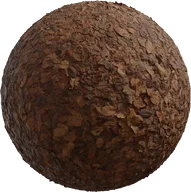</a> <b><a href="dry_decay_leaves">Dry Decay Leaves</a></b> by Amal Kumar · <a href="https://polyhaven.com/a/dry_decay_leaves">source</a> | <a href="dry_ground_01">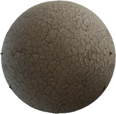</a> <b><a href="dry_ground_01">Dry Ground 01</a></b> by Rob Tuytel · <a href="https://polyhaven.com/a/dry_ground_01">source</a> | <a href="dry_ground_rocks">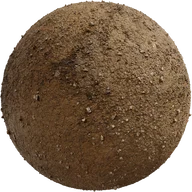</a> <b><a href="dry_ground_rocks">Dry Ground Rocks</a></b> by Rob Tuytel · <a href="https://polyhaven.com/a/dry_ground_rocks">source</a> | <a href="dry_mud_field_001">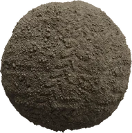</a> <b><a href="dry_mud_field_001">Dry Mud Field 001</a></b> by Rico Cilliers, Rob Tuytel · <a href="https://polyhaven.com/a/dry_mud_field_001">source</a> |
| <a href="dry_river_pebbles">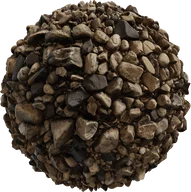</a> <b><a href="dry_river_pebbles">Dry River Pebbles</a></b> by Amal Kumar · <a href="https://polyhaven.com/a/dry_river_pebbles">source</a> | <a href="excavated_soil_wall">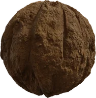</a> <b><a href="excavated_soil_wall">Excavated Soil Wall</a></b> by Amal Kumar · <a href="https://polyhaven.com/a/excavated_soil_wall">source</a> | <a href="farm_furrows">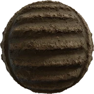</a> <b><a href="farm_furrows">Farm Furrows</a></b> by Amal Kumar · <a href="https://polyhaven.com/a/farm_furrows">source</a> | <a href="farm_soil">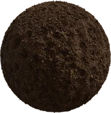</a> <b><a href="farm_soil">Farm Soil</a></b> by Amal Kumar · <a href="https://polyhaven.com/a/farm_soil">source</a> |
| <a href="floor_pebbles_01">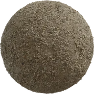</a> <b><a href="floor_pebbles_01">Floor Pebbles 01</a></b> by Rob Tuytel · <a href="https://polyhaven.com/a/floor_pebbles_01">source</a> | <a href="flower_scattered_dirt">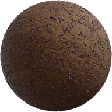</a> <b><a href="flower_scattered_dirt">Flower Scattered Dirt</a></b> by Dimitrios Savva · <a href="https://polyhaven.com/a/flower_scattered_dirt">source</a> | <a href="flower_scattered_gravel">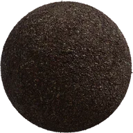</a> <b><a href="flower_scattered_gravel">Flower Scattered Gravel</a></b> by Dimitrios Savva · <a href="https://polyhaven.com/a/flower_scattered_gravel">source</a> | <a href="forest_floor">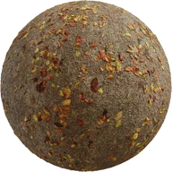</a> <b><a href="forest_floor">Forest Floor</a></b> by eye-candy.xyz · <a href="https://polyhaven.com/a/forest_floor">source</a> |
| <a href="forest_ground_04">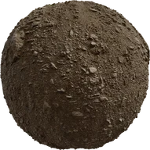</a> <b><a href="forest_ground_04">Forest Ground 04</a></b> by Rico Cilliers, Rob Tuytel · <a href="https://polyhaven.com/a/forest_ground_04">source</a> | <a href="forest_ground_05">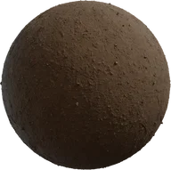</a> <b><a href="forest_ground_05">Forest Ground 05</a></b> by Charlotte Baglioni · <a href="https://polyhaven.com/a/forest_ground_05">source</a> | <a href="forest_ground_06">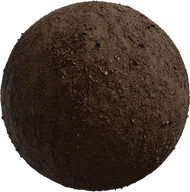</a> <b><a href="forest_ground_06">Forest Ground 06</a></b> by Charlotte Baglioni · <a href="https://polyhaven.com/a/forest_ground_06">source</a> | <a href="forest_leaves_02">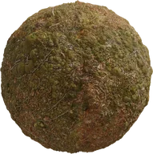</a> <b><a href="forest_leaves_02">Forest Leaves 02</a></b> by Rob Tuytel · <a href="https://polyhaven.com/a/forest_leaves_02">source</a> |
| <a href="forest_leaves_03">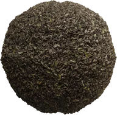</a> <b><a href="forest_leaves_03">Forest Leaves 03</a></b> by Dimitrios Savva, Rob Tuytel · <a href="https://polyhaven.com/a/forest_leaves_03">source</a> | <a href="forest_leaves_04">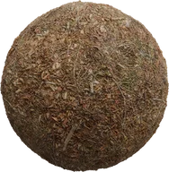</a> <b><a href="forest_leaves_04">Forest Leaves 04</a></b> by Rob Tuytel · <a href="https://polyhaven.com/a/forest_leaves_04">source</a> | <a href="forrest_ground_01">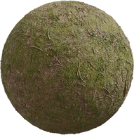</a> <b><a href="forrest_ground_01">Forest Ground 01</a></b> by Rob Tuytel · <a href="https://polyhaven.com/a/forrest_ground_01">source</a> | <a href="forrest_ground_03">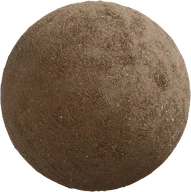</a> <b><a href="forrest_ground_03">Forest Ground 03</a></b> by Rob Tuytel · <a href="https://polyhaven.com/a/forrest_ground_03">source</a> |
| <a href="forrest_sand_01">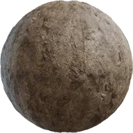</a> <b><a href="forrest_sand_01">Forest Sand 01</a></b> by Rob Tuytel · <a href="https://polyhaven.com/a/forrest_sand_01">source</a> | <a href="ganges_river_pebbles">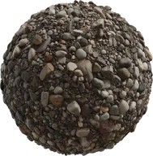</a> <b><a href="ganges_river_pebbles">Ganges River Pebbles</a></b> by Amal Kumar · <a href="https://polyhaven.com/a/ganges_river_pebbles">source</a> | <a href="grass_ground">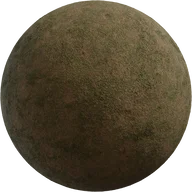</a> <b><a href="grass_ground">Grass Ground</a></b> by Charlotte Baglioni · <a href="https://polyhaven.com/a/grass_ground">source</a> | <a href="grass_path_2">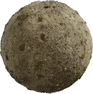</a> <b><a href="grass_path_2">Grass Path 2</a></b> by Rob Tuytel · <a href="https://polyhaven.com/a/grass_path_2">source</a> |
| <a href="grass_path_3">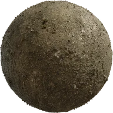</a> <b><a href="grass_path_3">Grass Path 3</a></b> by Rob Tuytel · <a href="https://polyhaven.com/a/grass_path_3">source</a> | <a href="gravel">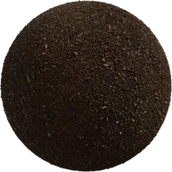</a> <b><a href="gravel">Gravel</a></b> by Dimitrios Savva · <a href="https://polyhaven.com/a/gravel">source</a> | <a href="gravel_floor">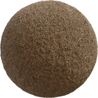</a> <b><a href="gravel_floor">Gravel Floor</a></b> by Jenelle van Heerden, Matterfield · <a href="https://polyhaven.com/a/gravel_floor">source</a> | <a href="gravel_floor_02">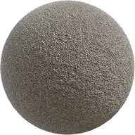</a> <b><a href="gravel_floor_02">Gravel Floor 02</a></b> by Dimitrios Savva, Jenelle van Heerden · <a href="https://polyhaven.com/a/gravel_floor_02">source</a> |
| <a href="gravel_floor_03">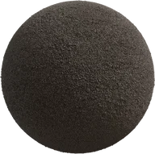</a> <b><a href="gravel_floor_03">Gravel Floor 03</a></b> by Charlotte Baglioni · <a href="https://polyhaven.com/a/gravel_floor_03">source</a> | <a href="gravel_floor_04">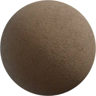</a> <b><a href="gravel_floor_04">Gravel Floor 04</a></b> by Charlotte Baglioni · <a href="https://polyhaven.com/a/gravel_floor_04">source</a> | <a href="gravel_ground_01">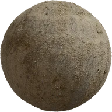</a> <b><a href="gravel_ground_01">Gravel Ground 01</a></b> by Rob Tuytel · <a href="https://polyhaven.com/a/gravel_ground_01">source</a> |  |

---

Kept up to date by this repository's own [update workflow](.github/workflows/update.yml), with code and plan from [cc0-mirror](https://github.com/zuujis-cc0/cc0-mirror). Something wrong? [Open an issue there](https://github.com/zuujis-cc0/cc0-mirror/issues/new) or use the [private report form](https://games.zuujis.com/report).
